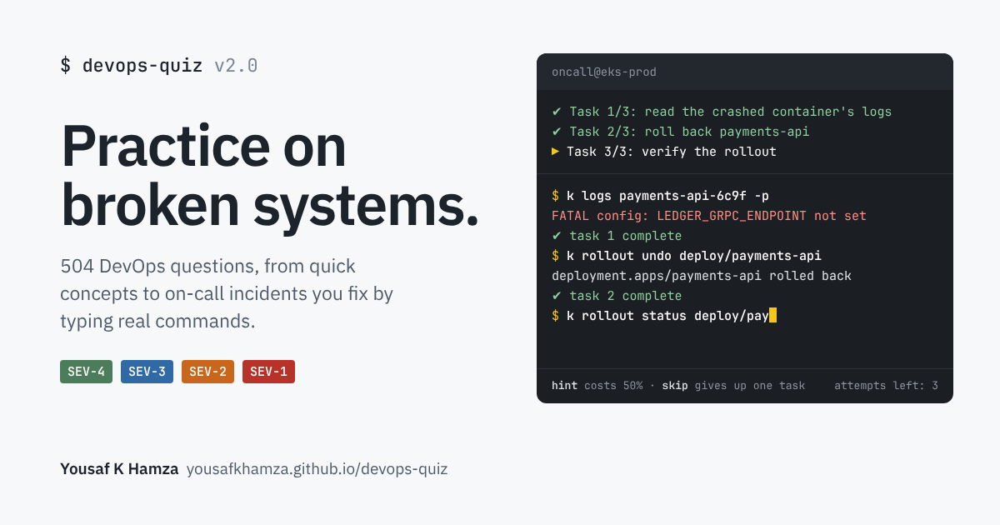

# DevOps Quiz 2.0

**Live:** https://yousafkhamza.github.io/devops-quiz/

**Scenario questions, live terminal labs, manifests to fill in and bugs to spot**, from quick concepts to multi-step production incidents.
It's 100% static, so it runs on GitHub Pages with no backend and no build step at runtime. Nothing leaves the browser.

by **Yousaf K Hamza** · [LinkedIn](https://www.linkedin.com/in/yousafkhamza/) · [Portfolio](https://yousafkhamza.github.io)



---

## What's new in 2.0

| | v1 | v2 |
|---|---|---|
| Question style | direct one-liners | real scenarios with logs, `kubectl` output, manifests, plans |
| Question types | MCQ | **MCQ · MULTI · LIVE terminal · MANIFEST fill · SPOT the bug · ORDER the runbook** |
| Difficulty | one level | **Easy → Medium → Hard → Super Hard**, plus a *Mixed ramp* |
| Modes | exam | **Exam** (timer, negative marks) · **Practice** (instant feedback) · **Demo tour** |
| Results | % and answer list | score ring, per-topic and per-level bars, explanations, "practise my mistakes", share to LinkedIn, local history |
| Topics | 10 | 16, each with at least 30 questions: AWS, Kubernetes, Docker, Linux, Bash, PowerShell, Python, Ansible, Terraform, Git, CI/CD, GitOps, Networking, Observability, Security, AI/MLOps |
| Hosting | InfinityFree + jsDelivr | **GitHub Pages** (relative paths, so any repo name works) |

### The levels

| Level | What it feels like | Points | Wrong | Time |
|---|---|---|---|---|
| **Easy** (289) | direct concepts, one answer (curated from v1, with fixes and explanations) | +1 | −0.25 | 1:00 |
| **Medium** (143) | read the logs, manifest or output and pick the right move | +2 | −0.5 | 2:00 |
| **Hard** (55) | live terminal sessions, fill the manifest, spot the bug | +3 | −0.75 | 4:00 |
| **Super Hard** (17) | 4–6 step incidents (node meltdown, Argo CD rollback, SG drift, cert-manager, OOM, leaked secret, Terraform refactor, a deploy script that wiped /opt) | +4 | −1 | 7:00 |

### Rules (same spirit as v1)

* Negative marking is 25% of the question's weight. Skips score 0.
* MULTI, SPOT and ORDER are all-or-nothing. LIVE and MANIFEST give partial credit per task or blank, and a fully failed attempt is negative-marked.
* On timeout the question locks and only **Skip** works. Terminal tasks and blanks already solved are kept.
* The score is shown only at the end in Exam mode.
* Switching tabs: a warning first, then the test exits. Paste is blocked in terminal and blank inputs. 5 exam attempts per day. Right-click and zoom are disabled during an exam.

### How the LIVE terminal works

The terminal is a *simulator*. Each task has **matchers** (regexes) for the commands that solve it, plus pre-recorded output.

* Commands are normalised first: whitespace is collapsed, a leading `$`/`sudo` is stripped, `k` → `kubectl`, `tf` → `terraform`.
* Flags can appear in any order, because matchers use `{ all: [...], none: [...] }` lookaheads.
* Exploration is free (`kubectl get pods`, `cat`, `git log`…). Only commands that look like an attempt at the current task (same first words as the solution, or a known wrong move) use one of the **3 attempts**.
* Built-ins: `help`, `hint` (the task is then worth 50%), `skip` (gives up just the current task: it scores 0, never negative, and you move on; there's also a **Skip this task** button), `tasks`, `history`, `clear`, and `solution` (practice only). ↑/↓ recall history.
* Labs cover kubectl, AWS CLI, Terraform, Docker, Git, Helm, Argo CD, Linux/systemd, Bash one-liners and ShellCheck, Python venv/pip, Ansible and PowerShell (case-insensitive, like the real thing).
* Labs can hold state. For example, Argo CD refuses `rollback` until you've disabled auto-sync, exactly like the real thing.

---

## Run locally

```bash
python3 -m http.server 8000     # then open http://localhost:8000
```

(Opening `index.html` straight from disk won't work, because browsers block `fetch()` on `file://`.)

## Deploy on GitHub Pages

1. Push to `main`.
2. **Settings → Pages → Source: GitHub Actions**.
3. `.github/workflows/pages.yml` validates the bank and deploys. PRs only run validation.

If you rename the repo again, update the absolute URLs in `index.html` (`og:url`, `og:image`, `twitter:image`) and `shareUrl` in `assets/js/config.js`. Everything else is relative.

The v1 files (`public/quiz.js`, `public/questions.json`, jsDelivr hosting) were removed in 2.0. They live on in the Git history.

---

## Repository layout

```
index.html                 app shell
assets/css/app.css         styles (dark, responsive)
assets/js/config.js        rules: weights, timers, negative ratio, attempts, strikes
assets/js/main.js          flow: setup → rules → quiz → result, timer, anti-cheat, history
assets/js/types.js         renderers + graders for every question type (incl. terminal)
assets/js/util.js          markdown-lite, syntax highlighting, storage
bank/*.yaml                ✍️  question SOURCE: easy/medium/hard/expert.yaml plus topic-*.yaml (any level per question), demo.yaml
data/*.json                generated from bank/ — served by Pages (committed)
scripts/build_bank.py      yaml → json + validation (regex compiles, every solution passes)
scripts/validate.mjs       re-checks every solution with the browser's JS regex engine
```

## Writing questions

Edit any `bank/*.yaml` (a level file, or the `topic-*.yaml` file for that topic; set `level:` per question), then:

```bash
pip install pyyaml
python3 scripts/build_bank.py && node scripts/validate.mjs
```

<details><summary>Examples for every type</summary>

```yaml
# MCQ / MULTI (answer is an index, or a list of indexes for multi)
- id: m-k8s-042
  category: Kubernetes
  type: mcq            # or: multi
  title: Exit code 137
  scenario: A Java service restarts under load.
  context:             # optional tabs: terminal | yaml | hcl | json | log | dockerfile | diff | text
    - kind: terminal
      title: describe
      content: |
        $ kubectl describe pod orders-abc | grep -A2 'Last State'
            Reason:  OOMKilled
  question: Best fix?
  options: [Raise the memory limit to the real working set, Add a CPU limit]
  answer: 0
  explanation: 137 = 128 + SIGKILL…

# LIVE terminal
- id: h-term-xyz
  type: terminal
  prompt: "oncall@eks:~$"
  explore:                          # free commands with canned output
    - match: "^kubectl get pods"
      output: "..."
      sets: some_flag               # optional lab state
  steps:
    - task: Roll back the deployment
      accept:
        - { all: ["^kubectl ", "rollout", "undo", "deploy(ment)?[/ ]api"], none: ["--dry-run"] }
      solution: kubectl rollout undo deployment/api
      hint: There's a rollout sub-command for that
      requires: some_flag           # optional: correct command refused until flag is set
      blocked: "error: ..."         # output when the precondition isn't met
      wrong:                        # realistic output for common wrong moves (uses an attempt)
        - match: "rollout restart"
          output: deployment.apps/api restarted
      output: deployment.apps/api rolled back
      tool: kubectl rollout         # optional: prefix (or list) that counts as an attempt (default: first 2 words of solution)
  ignoreCase: false                 # true for PowerShell-style labs

# MANIFEST fill — {{id}} placeholders in the template
- type: fill
  lang: yaml
  template: |
    kind: {{kind}}
  blanks:
    kind: { accept: ["^Deployment$"], solution: Deployment, width: 11 }

# SPOT — 1-based line numbers
- type: spot
  lang: dockerfile
  code: |
    FROM node:22
    USER root
  answer: [2]

# ORDER — write items in the CORRECT order; they're shuffled at runtime
- type: order
  items: [first, second, third]
```
</details>

---

## Changes to the v1 questions

* **Fixed wrong answers:** "always deployable" → *Continuous Delivery* (v1 said CI). `docker prune` doesn't exist → `docker system prune`. A "/24 CIDR block" question whose options were subnet masks has been reworded.
* **Modernised:** `netstat` → `ss -tulpn`, `docker-compose.yml` → `compose.yaml`, Jenkins-only CI → GitHub Actions, ambiguous SG/NACL, ARP/DNS and Secrets Manager/Parameter Store wording.
* **Removed:** "All of the options" questions, trivia (`users`), and a duplicate TLS question.
* **Explanations added** to every question. There are 35 new current-era Easy questions (Gateway API, EKS Pod Identity, IMDSv2, Karpenter, OIDC for CI, SHA-pinning actions, SBOM/cosign, OpenTofu, `import`/`moved` blocks, OpenTelemetry, SLO maths, GPU device plugin, MCP, prompt injection…).

## License

Personal learning, interview preparation and portfolio use. For commercial use, contact the author.
